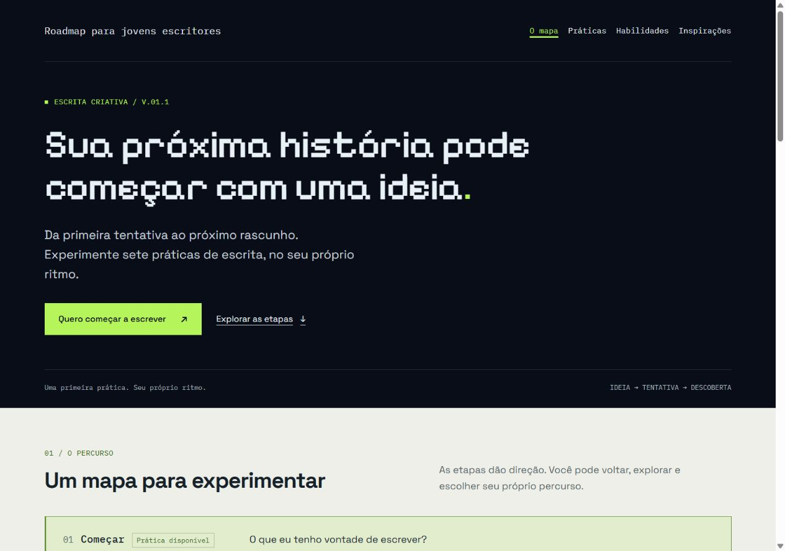
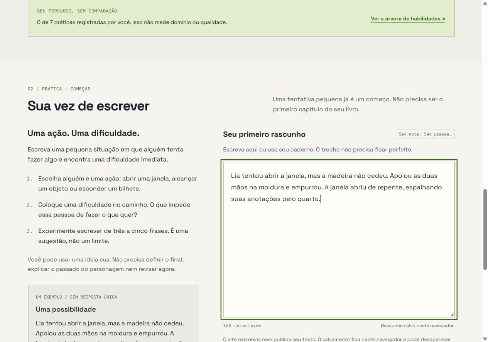
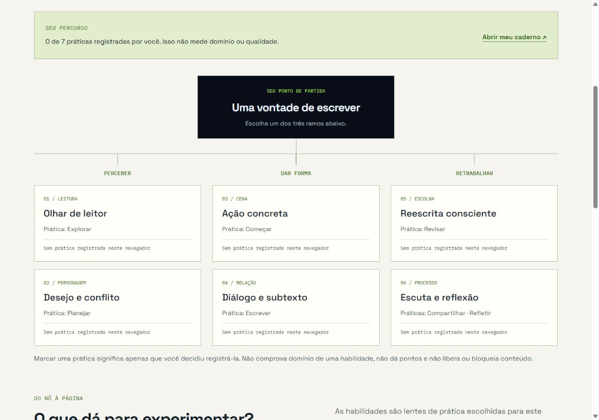
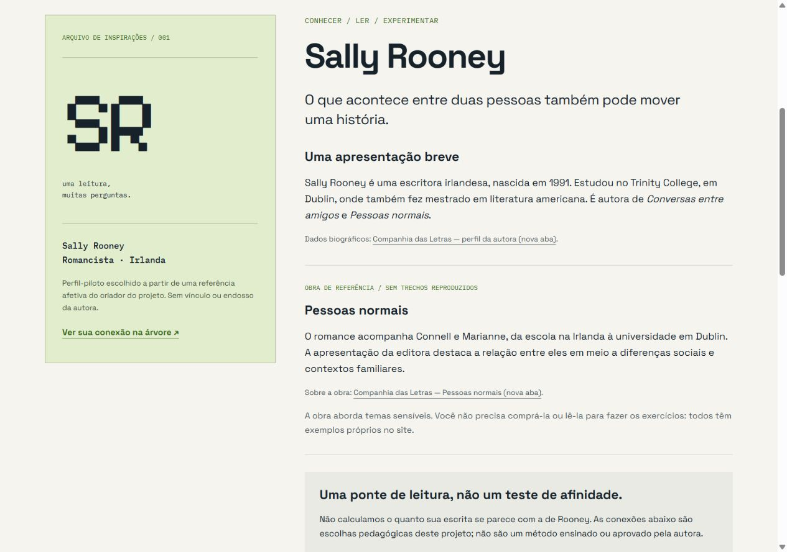
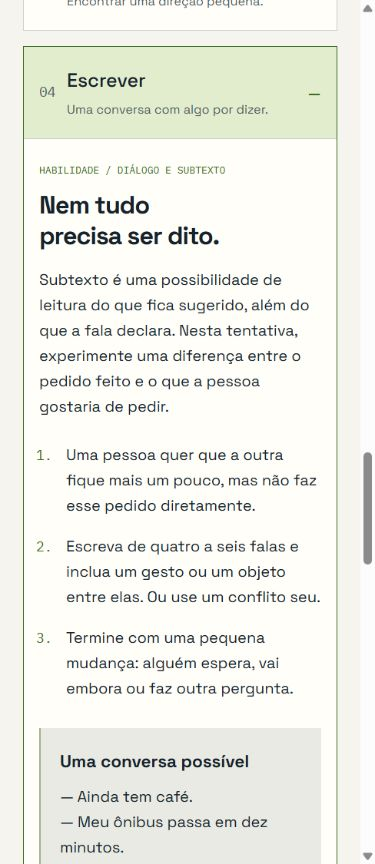

# Da ideia ao primeiro rascunho

**Roadmap para jovens escritores · projeto pessoal de interface e front-end**  
Luiz Albuquerque / Vision · V.01.1 · registro de 23/10/2026  
Estudo em construção; texto preparado para revisão antes de publicação.

## O ponto de partida

Queria construir meu primeiro projeto de programação unindo literatura, design de interfaces e front-end. A ideia inicial reunia muita coisa: caminhos de publicação, organização de histórias, exercícios, referências de autores e um roadmap.

A primeira dificuldade apareceu antes do código: decidir quem eu queria atender e qual seria a primeira ação dessa pessoa. Os layouts ajudavam a visualizar o projeto, mas não resolviam essa dúvida sozinhos.

O recorte passou a ser **quem quer escrever ficção em português, mas ainda não começou**. A pergunta de trabalho ficou: como oferecer uma primeira tentativa pequena, sem exigir que a pessoa planeje um livro inteiro?

Essa pergunta orienta o protótipo. Ainda não é uma conclusão validada com esse público.

## O caminho escolhido

Em vez de começar por uma plataforma completa, organizei uma primeira prática: alguém tenta realizar uma ação e encontra uma dificuldade imediata. A sugestão é escrever de três a cinco frases, sem limite rígido e sem precisar resolver a história inteira.

O mapa dá contexto, mas a prática oferece uma ação concreta. A pessoa pode escrever no site ou no próprio caderno.

As versões iniciais exploraram direções azuis, verdes e uma alternativa mais artística com imagens e textura. A direção verde foi mantida para a implementação. A alternativa ilustrada foi descartada deste recorte; não houve teste comparativo que demonstrasse superioridade de uma paleta ou estilo.

## Três decisões de interface

**Direção sem percurso obrigatório.** O mapa reúne Começar, Explorar, Planejar, Escrever, Revisar, Compartilhar e Refletir. As práticas podem ser acessadas sem desbloqueios.

**Registro sem nota.** Marcar uma prática registra uma escolha da pessoa, não avalia talento, qualidade ou domínio. A árvore conecta seis habilidades às atividades sem funcionar como ranking.

**Referência sem promessa de semelhança.** Sally Rooney foi escolhida como perfil-piloto por uma referência pessoal de leitura. As pontes entre leitura, desejo/conflito e diálogo/subtexto são propostas editoriais do projeto. Não são um método atribuído à autora nem uma avaliação de quanto alguém escreve como ela.

## O que foi implementado

O protótipo tem quatro páginas em HTML, CSS e JavaScript puro: início/mapa, práticas, habilidades e inspirações. São sete atividades com orientações, exemplos, campo de escrita e reflexão final.

Os rascunhos são salvos neste navegador, sem conta ou envio a um servidor. É possível copiar um trecho, baixar um arquivo `.txt` ou exportar os campos preenchidos da página de práticas como um caderno. Esse armazenamento não sincroniza dispositivos e pode ser perdido ao limpar os dados do navegador; o download é uma forma de manter uma cópia fora dele.

A direção visual combina fundo escuro na abertura, áreas claras de leitura e verde como destaque. Space Grotesk aparece no conteúdo; IBM Plex Mono em navegação e metadados; Pixelify Sans em títulos pontuais. A linguagem visual se aproxima dos meus estudos da Vision, sem colocar todo o texto em fonte de código.

## Meu papel e o apoio de IA

Conduzi a ideia, o recorte, as escolhas de direção visual e a revisão do projeto. Comecei a estrutura no VS Code em passos pequenos e depois usei o Codex para acelerar a implementação, revisar problemas, organizar conteúdo e produzir materiais de apresentação. O Figma apoiou a exploração visual.

Não apresento o código como escrito integralmente por mim sem assistência. O projeto também é um exercício de aprendizado: compreender e conseguir explicar a implementação faz parte do trabalho que continua.

O trailer é uma peça de apresentação, não uma gravação contínua de uso. Ele usa capturas de demonstração, movimento editorial e narração sintética. O exemplo mostrado no editor é fictício, não um texto de usuário.

## O que foi conferido — e o que ainda não sabemos

O registro técnico de 22/10/2026 documenta navegação entre as quatro páginas, recuperação de sete rascunhos independentes, cópia, exportação e registro/desmarcação de práticas. As páginas foram verificadas em larguras de 320, 390, 768 e 1280 px, sem transbordamento horizontal observado nessas condições.

Isso não equivale a validação de UX ou certificação de acessibilidade. Ainda não houve teste com iniciantes, aparelho físico, leitor de tela ou auditoria completa. Os relatos de comunidades e os materiais de IA usados na exploração não constituem entrevistas nem uma amostra representativa. Não há métricas de aprendizagem, retenção ou redução de bloqueio.

## O aprendizado e o próximo passo

O principal aprendizado até aqui foi perceber que um layout pode estar visualmente interessante e ainda deixar a proposta indefinida. Reduzir a primeira ação deu ao projeto um foco que as telas, sozinhas, não estavam conseguindo oferecer.

A próxima hipótese a investigar é se uma pessoa do público entende a primeira prática, consegue tentar e reconhece uma possibilidade de continuação. Uma proposta é observar de três a cinco pessoas — sem tratar esse número como validação estatística — e registrar dúvidas, momentos de hesitação e decisões de saída. Essa atividade ainda não foi realizada.

Antes de ampliar o banco de autores ou adicionar novas funções, quero usar essas observações para revisar instruções, hierarquia e continuidade. Em paralelo, ficam a revisão de acessibilidade e a consolidação do meu entendimento do código.

**O resultado atual é um protótipo funcional e documentado, não uma plataforma educacional validada.** É esse estágio real que vale apresentar.
